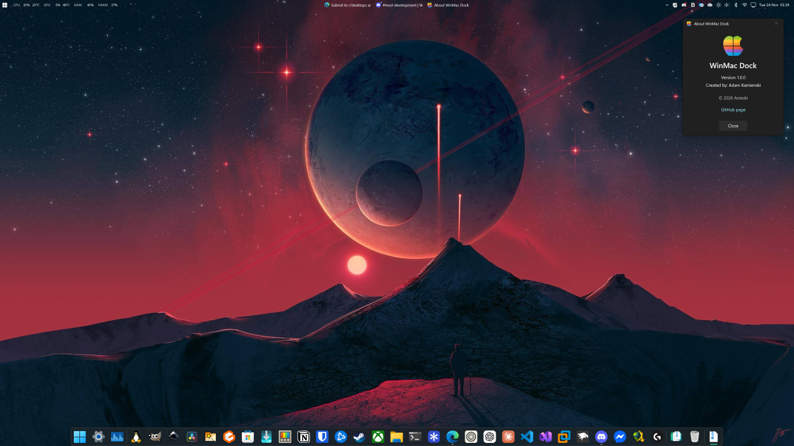
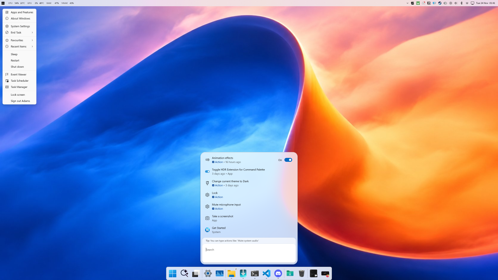
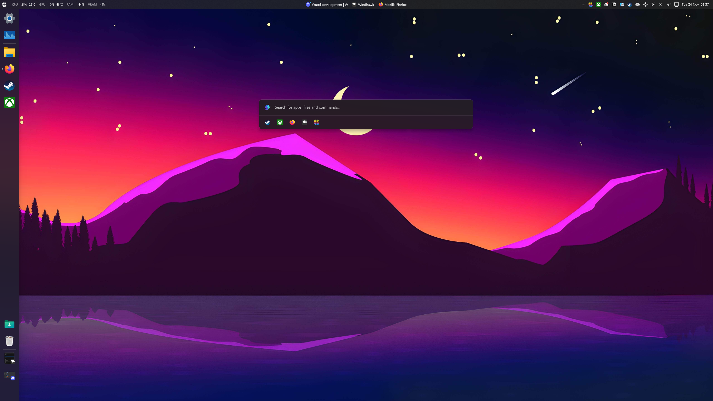
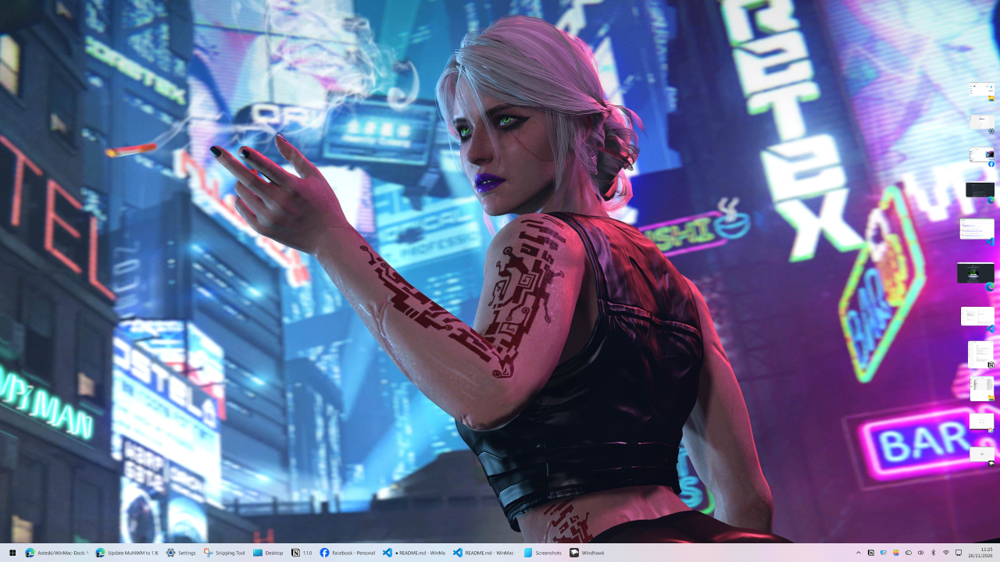

<p align="center">
  
</p>

<h1 align="center">
  <span>WinMac Dock</span>
</h1>
<h3 align="center">
  <span align="center">WinUI3 dock for Windows that looks and feels native</span>
</h3>
<p align="center">
  <span align="center">A standalone Windows 11 dock built with .NET 10, WinUI3, Windows Composition and the Windows shell. It offers native Windows Acrylic and Mica, solid/transparent backgrounds, system light/dark colors, multi-monitor setup, native WinUI menus, and macOS-style icon magnification.</span>
</p>

<p align="center">
    <a href="https://github.com/Asteski/WinMac-Dock/wiki">Documentation</a> |
    <a href="#Installation">Installation</a> |
    <a href="#using-the-dock">Getting started</a> |
    <a href="https://github.com/Asteski/WinMac-Dock/releases/">Releases</a> |
    <a href="https://github.com/Asteski/WinMac-Dock/wiki/Troubleshooting">Troubleshooting</a>
</p>

---

<p align="center">
  <a href="https://github.com/Asteski/WinMac-Dock/releases/download/v1.0.0/WinMac-Dock-1.0.0-x64-Setup.exe"></a>
  <a href="https://github.com/Asteski/WinMac-Dock/releases/download/v1.0.0/WinMac-Dock-1.0.0-arm64-Setup.exe"></a>
</p>
<p align="center">
  
  
</p>
<p align="center">
  
  
</p>

</p>
<p align="center">
  
</p>

<p align="center">
  
</p>

<details>
    <summary>Click for more images</summary>
    
    
    
    
</details>

---

**WinMac Dock is a customizable Windows 11 dock with macOS-style magnification, smooth animations, task grouping, window controls, and flexible positioning and alignment on any screen edge or display.**

- **Apps, files, folders and modules:** Pin applications (including _PWA_), folders, shortcuts and separators. Built-in modules include _Downloads, Recycle Bin, Start Menu, Task View_ and _Search_, with app-specific commands for _File Explorer, Settings, Microsoft Store, Terminal, Edge, Xbox_, _Snipping Tool_ and _Task Manager_.

- **Appearance:** Customize icon sizes, magnification, spacing, margins, borders, highlights, running indicators, and light/dark appearance. Choose _Acrylic_, _Mica_, _solid_ or _transparent_ backgrounds, or use _Default_ to match the Windows taskbar’s native background material.

- **Positioning and displays:** Place the dock along the top, bottom, left or right edge; adjust alignment, float it away from the edge, or span the full edge. Show it on one display or across all monitors, with independent positioning and behavior per display.

- **Window management:** Activate, minimize, restore or close windows from the dock. Optionally group windows by application, display only minimized applications, and direct Windows minimize/restore animations toward their dock icons.

- **Visibility:** Configure automatic hiding, edge reveal, fullscreen behavior and exclusions, screen-space reservation, and a customizable show/hide keyboard shortcut.

- **Folders and Downloads:** Browse folder contents in grid, list, or menu views, with sorting and folder-stack previews. Automatically pin newly downloaded files to a separate dock section, limit how many are retained, and optionally unpin them after opening. Automatically pin attached external disks, USB sticks and memory cards to a separate dock section.
  
- **Recycle Bin:** Drop files and folders onto its icon to recycle them, empty the bin from its context menu, and optionally play sounds for both actions. Customize its empty and full icons separately.

- **Per-item customization:** Change names, icons, launch arguments, working directories, and supported administrator-launch options. Customized item and module properties are remembered when unpinned and restored when pinned again.

- **Custom icons:** Use _ICO, PNG, JPG/JPEG, BMP, GIF, WebP_ or _SVG_ images, or select icons embedded in _DLL_ and _EXE_ files. Assign separate icons for light and dark mode.

- **Exclusions:** Exclude any running app from appearing in the dock by window title, process name, or window class.

- **Task View integration:** Keep the dock visible during Task View using the optional [Windhawk bridge mod](https://github.com/Asteski/WinMac-Dock/blob/a1e8460b41cd09a1d9ab7bce7c2282145a4a7200/mods/winmac-dock-task-view.wh.cpp).

## Installation

Windows 11 build **22621 or newer** is required. Choose **x64** for Intel/AMD PCs or **ARM64** for Windows on ARM.

- **NSIS installer:** choose between current user or all users installation, with optional Start menu and desktop shortcuts. All users installation requires administrator permission.
- **MSIX package:** install the package matching your architecture through Windows App Installer. For the privately signed packages, trust the supplied `WinMac-Dock-1.x.x.cer` certificate under **Local Computer > Trusted Root Certification Authorities** before installation. 
- **Portable package:** extract the matching ZIP and run `WinMac.Dock.exe`. Keep the published files and folders together.

Published builds are self-contained: a separate .NET installation is not required. 

Running the executable again opens Settings or activates the existing Settings window. Right-click the dock background or use its tray menu to access Settings and other commands.

### Installer commands

The NSIS installer supports silent installation and command-line help. Run the actual installer filename with `/HELP` or `/?` for its supported options.

```powershell
# Silent per-user installation; create the default shortcuts and then launch.
& '.\WinMac-Dock-1.x.x-x64-Setup.exe' /S /RUN

# Silent per-computer installation; requires elevation.
& '.\WinMac-Dock-1.x.x-x64-Setup.exe' /S /Machine

# Show installer or uninstaller help.
& '.\WinMac-Dock-1.x.x-x64-Setup.exe' /HELP
& "$env:LOCALAPPDATA\WinMac\Dock\Uninstall.exe" /HELP

# Silent uninstall while retaining user settings and the startup task.
& "$env:LOCALAPPDATA\WinMac\Dock\Uninstall.exe" /S /KEEP
```

The app stays closed after installation unless you select the launch option or supply `/RUN`. Fresh installations enable Start menu and desktop shortcuts by default. Re-running Setup detects an existing installation and offers maintenance actions. Uninstall stops the installed dock before removing its files. Configuration retention is selected interactively; silent uninstall removes accessible user configuration and its startup task unless `/KEEP` is supplied.

## Using the dock

- Pin applications, shortcuts, files, and folders by dragging them onto the dock or using its context menu. Removing a pin does not delete its target.
- Drag pinned items to reorder them. Lock icon positions to prevent rearranging and pinning by dropping. The optional Shift requirement controls dragging an item outside the dock to remove it.
- Click running applications to activate or restore their windows. Default clicks can minimize an active window; middle-click requests a normal close. Configure individual or default mouse-button actions in Settings or an item's context menu.
- Group windows of the same application, or keep separate window items. Combining pinned launchers with running windows is a separate setting. Windows from other virtual desktops are excluded unless **Show items from all virtual desktops** is enabled.
- **Minimize to dock** supplies Windows with the corresponding icon's minimize/restore destination. **Show minimized applications only** filters unpinned windows and requires Minimize to dock. Pinned launchers remain available.
- Use folder **Grid**, **List**, or native **Menu** views, with per-folder sorting, icon size, grid dimensions, and stacked previews. Custom light/dark icons and SVG artwork are supported.
- Downloads, connected drives, screenshots, and screen recordings can appear automatically. Configure these through Downloads, File Explorer, and Snipping Tool settings. **Item order** controls the order of automatic groups and running windows after pinned items.
- Recycle Bin supports empty/full icons, confirmation, separate recycling/emptying sounds, playback previews, and volume controls up to 200%.

For more information go to [Wiki Documentation page](https://github.com/Asteski/WinMac-Dock/wiki).

## Commands and configuration

```powershell
& '.\WinMac.Dock.exe' --settings
```

Supported app commands are `--startup`, `--show`, `--hide`, `--toggle`, `--settings`, `--about`, `--reload`, `--elevate`, `--exit`, and `--sync-startup`. Explicit commands are forwarded to an existing instance. A second launch without arguments opens Settings. Elevation uses Windows UAC.

The default activation shortcut is **Ctrl+Alt+D**; it can be changed or disabled. **Run at startup** registers a per-user Task Scheduler logon task named **WinMac Dock**, without a configured startup delay. `--sync-startup` repairs its registration from the saved preference.

Configuration is stored at `%LOCALAPPDATA%\WinMac\Dock\settings.json`. Saves replace it atomically and retain a backup. Existing preferences are retained; new options receive their defaults when missing from older configurations.

Logs are stored beside the configuration as `WinMac.Dock.log` and `WinMac.Dock.old.log`, with up to 1,000 physical lines per file. Windows can restrict interaction with elevated applications when the dock runs without administrator permission.
