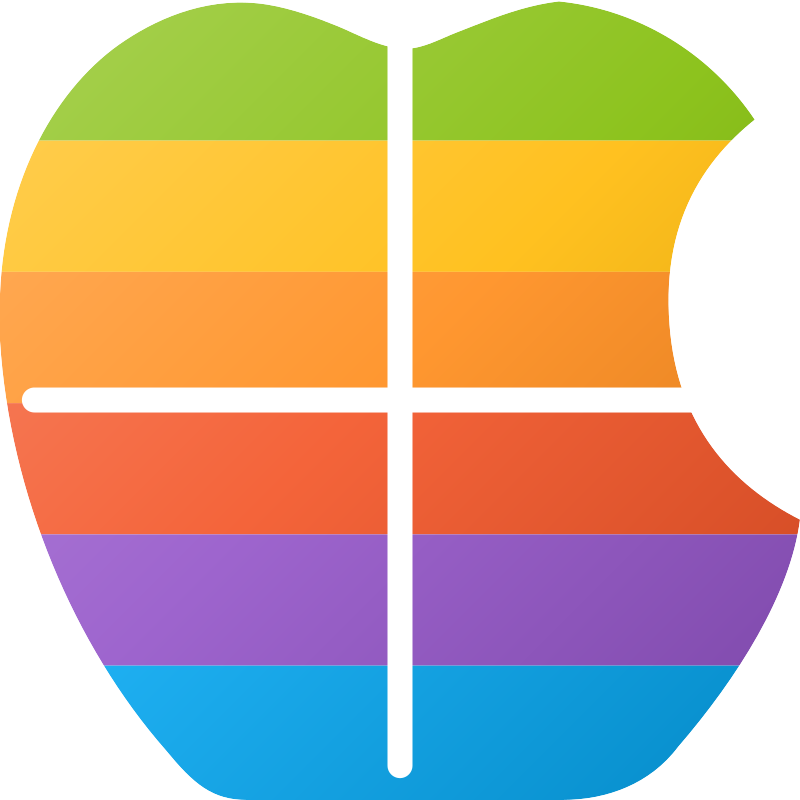

  

<h1 align="center">
  WinMac Dock
</h1>
<h3 align="center">
  WinUI3 dock for Windows that looks and feels native
</h3>

  A standalone Windows 11 dock built with .NET 10, WinUI3, Windows Composition and the Windows shell. It offers native Windows Acrylic and Mica, solid/transparent backgrounds, system light/dark colors, multi-monitor setup, native WinUI menus, and macOS-style icon magnification.

  

  

**WinMac Dock is a customizable Windows 11 dock with macOS-style magnification, smooth animations, task grouping, window controls, and flexible positioning and alignment on any screen edge or display.**

* It supports pinned apps, files, folders, and built-in modules or custom items including Start Menu, Downloads, Recycle Bin, File Explorer, Settings, Microsoft Store, Terminal, Edge, Task View, Search and Task Manager. Customize icons, spacing, margins, background material, highlights, docking behavior, automatic hiding, full-screen spanning, context menus, and per-item properties.

* Pinned folders and Downloads module provides grid and list views with sorting, file previews, folder navigation, and quick pinning. WinMac Dock also includes Task View integration through the optional [Windhawk bridge mod](https://github.com/Asteski/WinMac-Dock/blob/a1e8460b41cd09a1d9ab7bce7c2282145a4a7200/mods/winmac-dock-task-view.wh.cpp).

* Use modifier keys while clicking/dragging items: hold *Alt* to rearrange locked dock items, *Ctrl* to show/hide all windows, *Shift* to open new window, and *Ctrl+Shift* to open new window in administrative mode.

* Assign icons to dock items using _*.ico_, _*.png_, _*.jpg_, *_.bmp_, _*.svg_ and _*.dll_ file formats.
